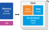

# CV32E40P 4-Core Standalone Verilator Testbench

A standalone testbench for a 4-core CV32E40P cluster.



- 4 CV32E40P cores
- 64MB Shared Memory, 20 Cycle Latency
- Each core has a 256kB scratchpad memory, local path fast
- Each scratchpad memory is accessible by all cores

## Memory Map

Defaults: `NUM_CORES=4`, `RAM_ADDR_WIDTH=26`, `SPM_ADDR_WIDTH=18`, `SPM_STRIDE_WIDTH=19`, `STACK_SIZE=16384`.
Address decoding lives in `tb/mm_ram.sv`, `tb/tb_cv32e40p_cluster_core.sv` and `tb/tb_cv32e40p_cluster_wrapper.sv`.

| Address range | Size | Target |
|---|---|---|
| `0x0000_0000` - `0x03FF_FFFF` | 64 MiB | Shared RAM: vectors at `0x0`, boot at `0x80`, code/data, heap (linker uses the first 4 MiB) |
| `0x1000_0000` | 4 B | Print (stdout) |
| `0x1500_0000` - `0x1500_0008` | 3 regs | Timer control / timer value / debug |
| `0x1500_1000` - `0x1500_1004` | 2 regs | Random number / cycle ticks |
| `0x1500_2000` - `0x1500_2084` | | Event unit (barriers) |
| `0x1500_3000` - `0x1500_3018` | | Per-core DMA (each core sees its own engine) |
| `0x1600_0000` - `0x1600_FFFF` | 64 KiB | Random-stall configuration |
| `0x1800_0000` + n * `0x8_0000` | 256 KiB | Scratchpad of core n (n = 0..3) |
| `0x1804_0000` + n * `0x8_0000` | 256 KiB | Unmapped guard gap after scratchpad n |
| `0x1A11_0800` - `0x1A11_47FF` | 16 KiB | Debug module region |
| `0x2000_0000` - `0x2000_0010` | 5 regs | Test status / exit / signature |

Any data access outside these regions, including the guard gaps, stops the simulation with `[TB] UNMAPPED READ/WRITE ACCESS addr=...`.
CV32E40P has no bus-error input, so this testbench check stands in for an access fault.

### Stacks

Each core's stack lives at the start of its own scratchpad:

```
SPM_ADDR(n)                      SPM_DATA_ADDR(n)                    SPM_ADDR(n) + 256 KiB
|<-- stack (STACK_SIZE) --------->|<-- usable scratchpad data ------->|<-- guard gap (256 KiB) -->
         grows down from SPM_DATA_ADDR(n)
```

The initial `sp` is `SPM_ADDR(n) + STACK_SIZE`. A stack overflow runs into the guard gap of core n-1 (or below `0x1800_0000` for core 0) and stops the simulation.
Use `SPM_DATA_ADDR(core)` / `SPM_DATA_PTR(core)` / `SPM_DATA_SIZE` from `sw/cluster_sync.h` for scratchpad data. Writing at `SPM_ADDR(core)` clobbers that core's stack.
The linker exports the same offset as `__spm_data_offset` (equal to `__stack_size`).

The stack size is configurable with `make STACK_SIZE=<bytes>` (a positive multiple of 16, at most 256 KiB). It is passed to both the linker (`__stack_size`) and the compiler (`CL_STACK_SIZE`), and changing it rebuilds the firmware.

## Prerequisites

- Verilator in `PATH`
- CORE-V toolchain in `/opt/corev`

## Run

```sh
cd cv32e40p-verilator-cluster4
git submodule update --init --recursive
make run
```

## Pytest

The repository includes a pytest-based smoke test that builds the Verilator model and runs the example applications in `sw/`:

```sh
pytest -v
```

Default app expected output includes:

- `SHARED MEM DEMO PASS sum=10`
- `[TB] CLUSTER EXIT SUCCESS`

Note: stdout characters from 4 cores are written to the same MMIO location and may interleave.

## Low-power wait hint

`sw/cluster_sync.h` supports an optional `wfi` wait hint (`USE_WFI_WAIT=1`).
By default it is disabled for safety because CV32E40P `wfi` can enter sleep if no wake interrupt is configured.

This behavior is documented in CV32E40P sleep docs:

- `cv32e40p/docs/source/sleep.rst`

## Useful targets

- `make firmware` : build `build/fw/shared-memory-demo.elf` and `build/fw/shared-memory-demo.hex`
- `make APP=hello-world firmware` : build an alternate app source from `sw/hello-world.c`
- `make APP=reduction-demo run` : parallel reduction demo
- `make APP=tiled-matmul-demo run` : tiled matrix multiplication demo
- `make APP=dma-demo run` : DMA memcpy demo (128-element copy and verify)
- `make APP=perfcounter-demo run` : use `mhpmcounter3` to compare pipeline stall counts for shared memory vs local scratchpad loads
- `make APP=barrier-skew-demo run MAXCYCLES=20000000` : barrier stress test with one slow hart and other fast harts
- `make verilate` : compile RTL/testbench with Verilator
- `make run MAXCYCLES=5000000` : run with a custom cycle limit
- `make APP=scratchpad-demo run STACK_SIZE=8192` : run with an 8 KiB per-core stack
- `make APP=stack-overflow-test run` : overflow hart 1's stack into the guard gap (expected to stop with `UNMAPPED WRITE ACCESS`)
- `make clean` : remove build artifacts

## Optional waveform dump

Enable VCD tracing by passing `VERI_TRACE=--trace` and enabling `VCD_TRACE` in C++ compile flags, for example:

```sh
make clean
make run VERI_TRACE=--trace VERI_CFLAGS="-O2 -DVCD_TRACE"
```

The waveform file is written to `build/verilator/waves.vcd`.
